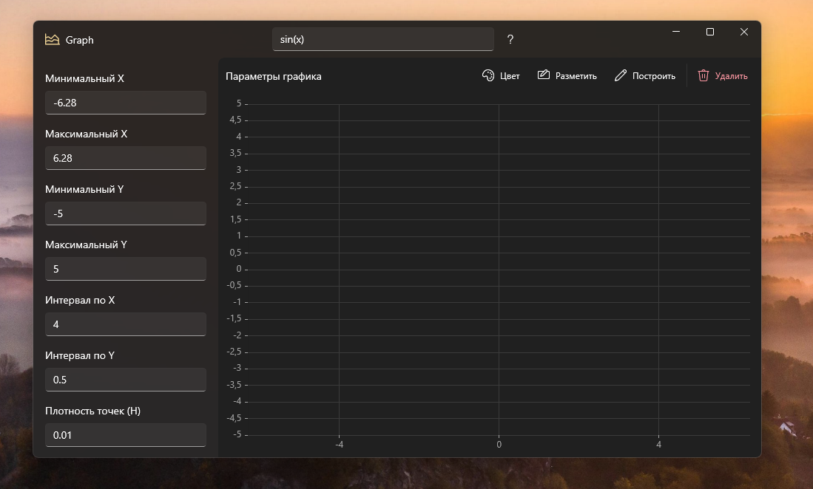
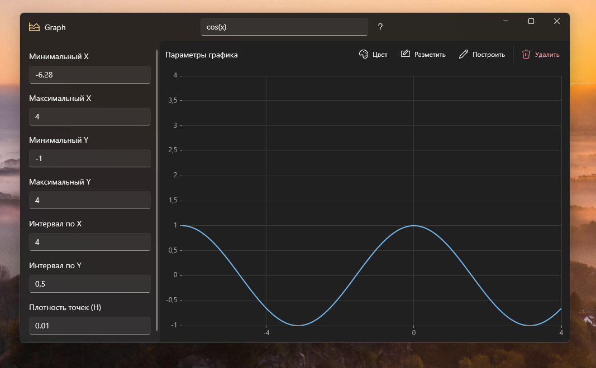
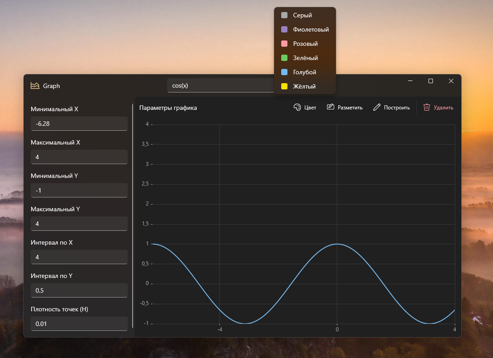
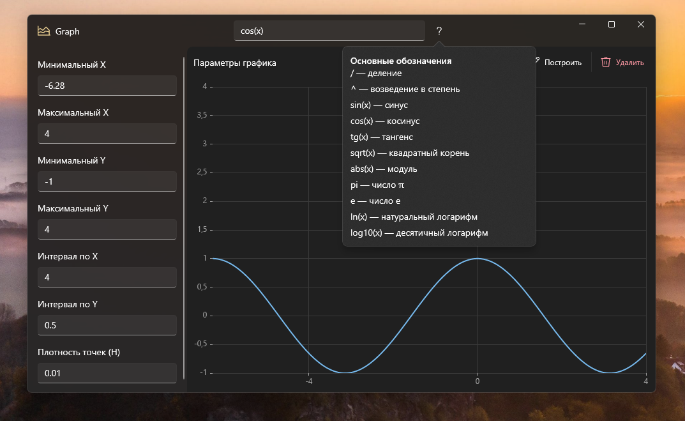
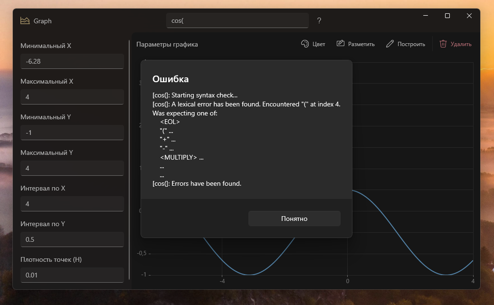

# Graph

**Graph** — настольное приложение для Windows для построения графиков математических функций одной переменной \(y = f(x)\).

Введи математическое выражение, задай диапазон координат и шаг вычислений — приложение рассчитает значения функции и отобразит кривую на координатной плоскости. Интерфейс создан на WinUI 3 с использованием Fluent Design.



## Возможности

- **Построение функций.** Ввод выражений с переменной `x` и построение соответствующего графика.
- **Настройка диапазона.** Независимые минимальные и максимальные значения по X и Y.
- **Настройка разметки осей.** Отдельный интервал числовых делений для каждой оси.
- **Настройка плотности вычислений.** Шаг `H` определяет расстояние между вычисляемыми точками.
- **Выбор цвета кривой.** Шесть готовых цветов: серый, фиолетовый, розовый, зелёный, голубой и жёлтый.
- **Встроенная справка.** Подсказка по основным операторам, функциям и математическим константам.
- **Проверка выражений и параметров.** Ошибки ввода отображаются в диалоговом окне.
- **Светлая и тёмная темы.** Оформление графика адаптируется к активной теме приложения.

## Построение графика

Введи выражение в поле функции в верхней части окна и нажми **«Построить»**. Graph вычислит функцию в заданном диапазоне X и отобразит результат.

Примеры выражений:

| Выражение      | Результат        |
| -------------- | ---------------- |
| `sin(x)`       | Синусоида        |
| `cos(x)`       | Косинусоида      |
| `x^2`          | Парабола         |
| `sqrt(abs(x))` | Корень из модуля |
| `1/x`          | Гипербола        |

Для разбора и вычисления выражений используется **MathParser.org-mXparser**.

Основные обозначения:

| Обозначение                 | Значение                       |
| --------------------------- | ------------------------------ |
| `+`, `-`, `*`, `/`          | Арифметические операции        |
| `^`                         | Возведение в степень           |
| `sin(x)`, `cos(x)`, `tg(x)` | Тригонометрические функции     |
| `sqrt(x)`                   | Квадратный корень              |
| `abs(x)`                    | Абсолютное значение            |
| `ln(x)`                     | Натуральный логарифм           |
| `log10(x)`                  | Десятичный логарифм            |
| `pi`, `e`                   | Математические константы π и e |



## Настройка координатной области

В левой панели доступны семь параметров:

| Параметр            | Назначение                                    |
| ------------------- | --------------------------------------------- |
| Минимальный X       | Левая граница диапазона                       |
| Максимальный X      | Правая граница диапазона                      |
| Минимальный Y       | Нижняя граница диапазона                      |
| Максимальный Y      | Верхняя граница диапазона                     |
| Интервал по X       | Расстояние между делениями горизонтальной оси |
| Интервал по Y       | Расстояние между делениями вертикальной оси   |
| Плотность точек (H) | Шаг вычисления значений функции               |

Кнопка **«Разметить»** применяет текущие границы и интервалы осей. Кнопка **«Построить»** вычисляет функцию с заданными параметрами. Кнопка **«Удалить»** очищает область графика.

Количество вычисляемых точек ограничено **200 000**. Это ограничение защищает приложение от чрезмерно больших вычислений при слишком маленьком шаге H. Значения функции, которые не являются конечными числами, пропускаются.

## Цвет и оформление графика

Цвет кривой можно выбрать в меню **«Цвет»**. Палитра содержит шесть вариантов. Выбор применяется к уже построенному графику и сохраняется для следующего построения.



Область построения оформлена минималистично: без внешней рамки и подписей X/Y, с числовой разметкой и фоновой сеткой. Цвета фона, осей и сетки подстраиваются под светлую или тёмную тему.

## Встроенная справка

Кнопка со знаком вопроса рядом с полем функции открывает подсказку **TeachingTip**. В ней собраны примеры математических операторов, тригонометрических функций, корней, логарифмов и констант.



## Обработка ошибок

Перед вычислением приложение проверяет выражение и параметры. Проверяются корректность чисел, порядок минимальных и максимальных границ, положительные значения шага H и интервалов разметки, а также максимальное количество точек. При ошибке появляется **ContentDialog** с описанием проблемы.



## Установка

Запускаемый файл приложения — **Graph.WinUI.exe**. Это имя соответствует свойству `AssemblyName` в `Graph.WinUI.csproj`. Установщик копирует весь каталог публикации и запускает именно этот EXE из установленной папки.

### Создание установщика

Требуются Windows, .NET 10 SDK.

1. Открой PowerShell в корневой папке репозитория.
2. Опубликуй приложение для x64:

```powershell
dotnet publish .\Graph.WinUI\Graph.WinUI.csproj -c Release -r win-x64 --self-contained true -p:WindowsAppSDKSelfContained=true -p:WindowsPackageType=None -o .\artifacts\publish\win-x64
```

3. Убедись, что опубликованный EXE существует:

```powershell
Test-Path .\artifacts\publish\win-x64\Graph.WinUI.exe
```

Команда должна вернуть `True`.

4. При необходимости проверь запуск опубликованной версии напрямую:

```powershell
$publishDir = ".\artifacts\publish\win-x64"
Start-Process -FilePath (Join-Path $publishDir "Graph.WinUI.exe") -WorkingDirectory $publishDir
```

## Сборка и запуск из исходного кода

### Требования

- Windows 10 версии 2004 (сборка 19041) или новее, x64.
- .NET 10 SDK.
- Подключение к интернету при первом восстановлении NuGet-пакетов.

### Команды

Запускай из корневой папки репозитория:

```powershell
dotnet restore .\Graph.sln
dotnet build .\Graph.sln -c Debug -p:Platform=x64
dotnet test .\Graph.WinUI\Tests\Tests.csproj -c Debug
dotnet run --project .\Graph.WinUI\Graph.WinUI.csproj -c Debug -p:Platform=x64
```

## Структура проекта

```text
Graph/
├── Graph.sln
├── Graph.iss
└── Graph.WinUI/
    ├── App.xaml
    ├── MainWindow.xaml
    ├── MainWindow.xaml.cs
    ├── Graph.WinUI.csproj
    ├── ViewModels/
    │   └── MainViewModel.cs
    ├── Core/
    │   ├── Core.csproj
    │   ├── GraphCalculator.cs
    │   ├── GraphParameters.cs
    │   └── GraphResult.cs
    └── Tests/
        ├── Tests.csproj
        └── GraphCalculatorTests.cs
```

### Проекты решения

- **Graph.WinUI** — интерфейс WinUI 3, взаимодействие с пользователем и отображение графика.
- **Core** — библиотека вычисления функций и проверки параметров. Пространство имён исходного кода: `Graph.Core`.
- **Tests** — модульные тесты математического ядра на xUnit. Пространство имён тестов: `Graph.Tests`.

## Используемые технологии

- [.NET 10](https://dotnet.microsoft.com/)
- [WinUI 3 / Windows App SDK](https://learn.microsoft.com/windows/apps/winui/winui3/)
- [ScottPlot](https://scottplot.net/) — построение графиков
- [CommunityToolkit.Mvvm](https://learn.microsoft.com/dotnet/communitytoolkit/mvvm/) — реализация MVVM
- [MathParser.org-mXparser](https://mathparser.org/) — разбор и вычисление выражений
- [xUnit](https://xunit.net/) — модульное тестирование

## Тестирование

Проект `Tests` проверяет математическое ядро: вычисление квадратичной функции, отклонение нулевого и отрицательного шага, проверку диапазона X, ограничение числа точек и обработку некорректного выражения.
